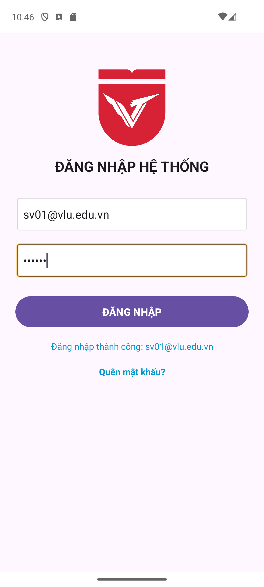
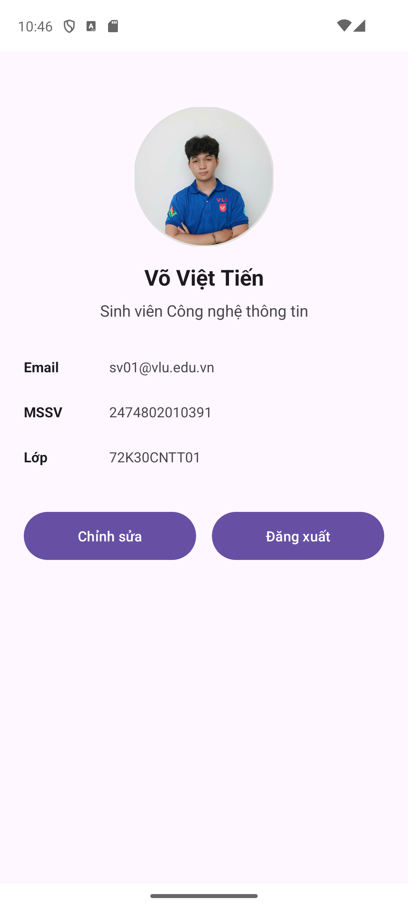
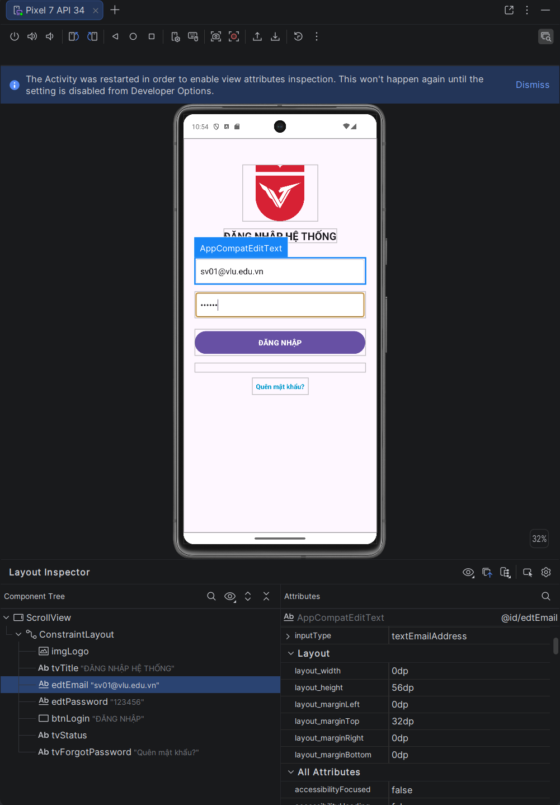
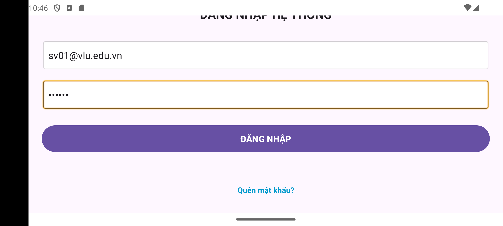

# Lab 2 – Thiết kế giao diện XML & ViewBinding

- **Sinh viên:** Võ Việt Tiến
- **MSSV:** 2474802010391
- **Lớp:** 72K30CNTT01
- **Môn:** Lập trình ứng dụng di động – Văn Lang University

Ứng dụng Android (Kotlin) gồm hai màn hình **Đăng nhập** và **Hồ sơ người dùng**, xây dựng bằng `ConstraintLayout` phẳng và `ViewBinding` (không dùng `findViewById`).

## Chức năng

| Mã | Yêu cầu | Thực hiện |
|----|---------|-----------|
| R1 | Màn hình Đăng nhập: logo, tiêu đề, Email, Mật khẩu, nút Đăng nhập, dòng trạng thái | `activity_login.xml` – chuỗi neo dọc `imgLogo → tvTitle → edtEmail → edtPassword → btnLogin → tvStatus` |
| R2 | Kiểm tra dữ liệu: để trống, email sai định dạng, mật khẩu < 6 ký tự | `LoginActivity.handleLogin()` dùng `when` + `Patterns.EMAIL_ADDRESS` |
| R3 | Đăng nhập hợp lệ ⇒ "Đăng nhập thành công: &lt;email&gt;" | Hiển thị tại `tvStatus` và chuyển sang `ProfileActivity` qua `Intent` |
| R4 | Profile: avatar tròn 1:1, tên, vai trò, 3 dòng thông tin, 2 nút chia đều | `ShapeableImageView` bo tròn 50%, chain ngang 2 nút `layout_constraintHorizontal_weight="1"` |
| R5 | ConstraintLayout + ViewBinding, chuỗi trong `strings.xml` | `buildFeatures { viewBinding = true }`, toàn bộ chuỗi ở `values/strings.xml` |

**Bài tập vận dụng đã làm**

- Cấp 1: dòng "Quên mật khẩu?" căn giữa dưới `tvStatus`, nhấn hiện Toast.
- Cấp 1: toàn bộ chuỗi nằm trong `strings.xml`, có bản tiếng Anh tại `values-en/strings.xml`.
- Cấp 3: bọc layout trong `ScrollView` để không bị cắt khi xoay ngang hoặc khi bàn phím hiện lên.

## Kịch bản kiểm thử

| Tình huống | Dữ liệu | Kết quả mong đợi |
|------------|---------|------------------|
| Để trống | Email/mật khẩu rỗng | Toast + "Trạng thái: Vui lòng điền đủ dữ liệu" |
| Email sai định dạng | `abc` / `123456` | Lỗi "Email không hợp lệ" tại ô Email |
| Mật khẩu ngắn | `sv01@vlu.edu.vn` / `123` | Lỗi "Mật khẩu tối thiểu 6 ký tự" |
| Hợp lệ | `sv01@vlu.edu.vn` / `123456` | "Đăng nhập thành công: sv01@vlu.edu.vn" và mở màn hình Profile |

## Ảnh chụp màn hình

| Đăng nhập | Hồ sơ | Layout Inspector |
|-----------|-------|------------------|
|  |  |  |

**Xoay ngang:** nhờ `ScrollView`, nút ĐĂNG NHẬP vẫn cuộn tới được.

## Cách chạy

1. Clone repo và mở bằng Android Studio.
2. Đợi Gradle Sync hoàn tất.
3. Chạy trên AVD (Shift + F10).
